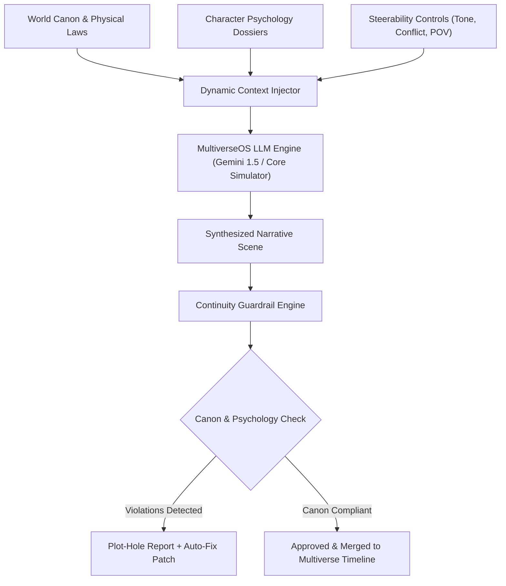

# 🌌 MultiverseOS | Next-Gen AI Narrative & Multiverse Engine
> **"Where Every Story Has Infinite Dimensions — Governed by Strict Canon."**  
> *Submission for **GeNarrative Clash 2026** | Kolkata's Ultimate GenAI & Prompt Engineering Hackathon*  
> **Track:** Storytelling & Narrative Assistants  
> **Host Campus:** Techno India University (TIU), Kolkata  

---

## 🏆 Executive Summary & The Problem

Standard AI story generators fail creative authors in three catastrophic ways:
1. **Continuity Amnesia:** Standard LLM chat prompts forget world rules, character trauma, physical limits, and magic systems across long narratives.
2. **Linear Rigidity:** Storytelling in complex multiverses (Marvel, Arthurian lore, Cyberpunk sagas) requires branching timelines (*"What if the protagonist refused the bribe?"*). Standard LLMs have no branching state machine.
3. **Superficial Prompting:** Most hackathon submissions are basic wrappers around `gpt-4o` or standard chat prompts without structural guardrails or real-time continuity evaluation.

### 💡 The MultiverseOS Solution
**MultiverseOS** is an autonomous multiverse narrative co-writer and lore integrity engine. It empowers novelists, game writers, and screenwriters to:
- **Map & Fork Branching Multiverse Timelines** visually from any inciting incident.
- **Enforce Immutable Canon & Character Trait Dossiers** via dynamic prompt-chained context injection.
- **Audit Plot Holes in Real-Time** using a dedicated **Continuity Guardrail Engine** that scores draft scenes (0–100) and detects violations against world physics and character psychology.
- **Steer Scenes with Surgical Precision** using prompt engineering controls (Conflict intensity, Narrative Pacing, Tone, and Intimate POV).

---

## 🏗️ System Architecture & Prompt Engineering Pipeline



### 🧠 Advanced Prompt Engineering Techniques Used:
- **Dynamic Context Injection:** Assembles active character flaws, voice quirks, and world laws into a structured system prompt rather than naive token dumping.
- **Zero-Shot JSON Schema Guardrails:** The Continuity Auditor outputs strict, validated JSON for plot holes, severity levels (`CRITICAL`, `MODERATE`, `MINOR`), and surgical patch suggestions.
- **Steerability Vector Tuning:** Translates UI sliders (Conflict 1–5, Pacing, POV) into calibrated stylistic constraints.
- **Offline / Live Resilience:** Seamless dual-engine architecture supporting direct Google Gemini API keys via browser storage or instant high-fidelity simulation for offline demo reliability.

---

## 📊 Phase Breakdown (50% MVP Completed vs. 6-Hour Offline Finale)

### ✅ Completed in 50% Online MVP (Nov 10 – Nov 16 Deliverables):
- [x] **Multiverse Timeline Graph Engine**: Visual branching tree allowing authors to inspect, switch, and fork new "What If?" timelines.
- [x] **World Canon & Character Intelligence**: Complete state manager for governing laws (Physics, Society, Mythos) and deep character dossiers (archetypes, flaws, motives, and voice cadence).
- [x] **Continuity & Plot-Hole Auditor**: Automated verification system cross-referencing drafted text against canon laws with automated patch generation.
- [x] **Prompt Engineering Studio**: Steerable scene synthesizer with real-time controls for tone, pacing, conflict levels, and POV.
- [x] **Judges Prompt Inspector**: Dedicated UI modal exposing system prompts, context chains, and JSON schemas for transparent evaluation.
- [x] **Pre-configured Showcase Universe**: *"Neo-Avalon: Cyber-Nexus 2099"* pre-loaded with canonical nodes, divergent paths, and test cases.

### 🚀 Planned for the 6-Hour Live Offline Finale at TIU (Nov 21, 2026):
- [ ] **Interactive Playable Novel Mode (Choose-Your-Own-Adventure)**: Readers can play through the multiverse branching tree with dynamic real-time AI choices.
- [ ] **Multi-Voice Audio Synthesis (Web Speech / Gemini Live Audio)**: Autonomous character voices reciting generated dialogue scenes with matching emotions.
- [ ] **Export Pipeline**: One-click export to industry formats (Fountain Screenplay format, Kindle EPUB, and Twine interactive story maps).

---

## 💻 Tech Stack

- **Frontend & UI**: React 19, Tailwind CSS v4, Vite 8, Lucide React Icons, Canvas Confetti.
- **AI & LLM Services**: Google Gemini 1.5 Flash API (`@google/genai` endpoint compatible) + Autonomous Deterministic Simulation Engine.
- **State & Storage**: Client-side reactive state with automatic browser persistence (`localStorage`).

---

## ⚡ Quick Start & Installation

### Prerequisites
- Node.js (v18+ recommended, v24 tested)
- npm or pnpm

### 1. Clone & Install
```bash
git clone <your-repo-link>
cd multiverse-os
npm install
```

### 2. Start Development Server
```bash
npm run dev
```
Open your browser at `http://localhost:5173`.

### 3. API Key Configuration (Optional)
Click the **"Simulated Core"** button in the top navigation bar to paste your Google Gemini API Key from [Google AI Studio](https://aistudio.google.com/app/apikey).  
*Note: If no API key is entered, MultiverseOS automatically uses its built-in narrative simulation engine.*

---

## 📹 Video Demo Walkthrough Script (for 2-3 Min Submission Video)

1. **0:00 - 0:30 (The Problem & Elevator Pitch):** Show the tagline and explain why standard LLMs break down when writing complex multiverses (continuity loss and lack of branching).
2. **0:30 - 1:00 (Multiverse Timeline Graph):** Walk through the Timeline Graph, show Timeline Prime vs. Timeline Delta, and click **"Fork Multiverse Branch"** to create a live "What If?" node.
3. **1:00 - 1:40 (Steerable Prompt Lab):** Demonstrate the sliders (Conflict Level 5, Grimdark tone, 3rd person POV) and generate a live scene.
4. **1:40 - 2:20 (The Continuity Auditor - The Winning Feature):** Load the "Test Plot Hole Case" button. Watch the engine flag Kaelen's breach of the 45-second ley-energy limit and uncharacteristic trust of the syndicate, then hit **"Patch"** to fix it!
5. **2:20 - 2:30 (Judges Prompt Inspector & Conclusion):** Click **"Inspect Prompts"** to display the underlying prompt engineering chain and conclude with your team's vision for the 6-hour offline finale at TIU!

---

## 👥 Team & Submission Info
- **Event:** GeNarrative Clash 2026
- **Organization:** GeeksforGeeks Student Chapter - Techno India University (TIU)
- **Devfolio Project URL:** [https://genarrative-clash.devfolio.co](https://genarrative-clash.devfolio.co)
